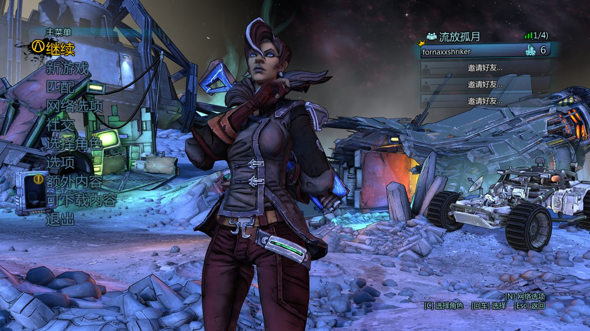
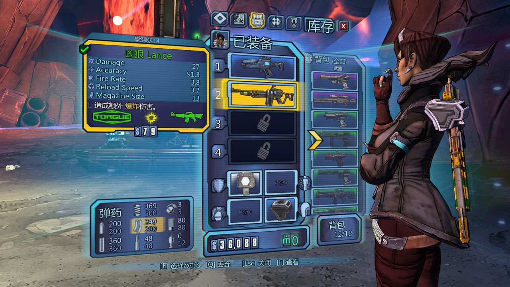
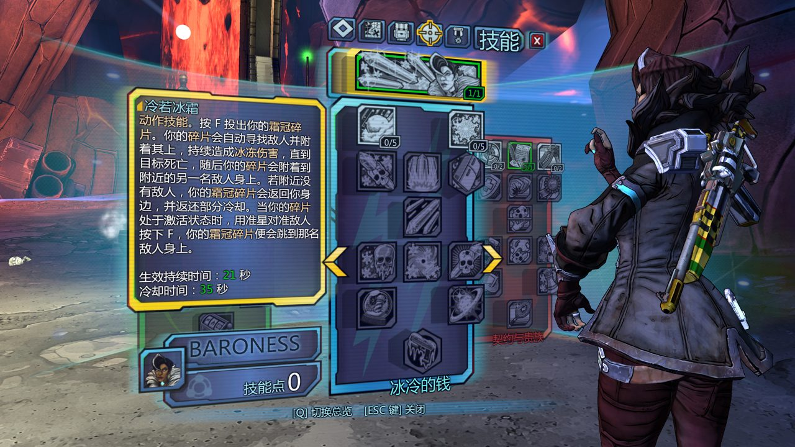
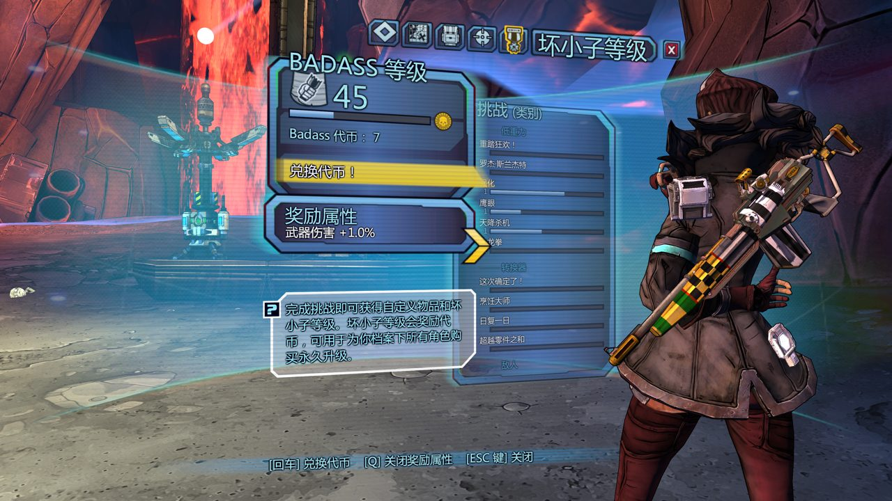
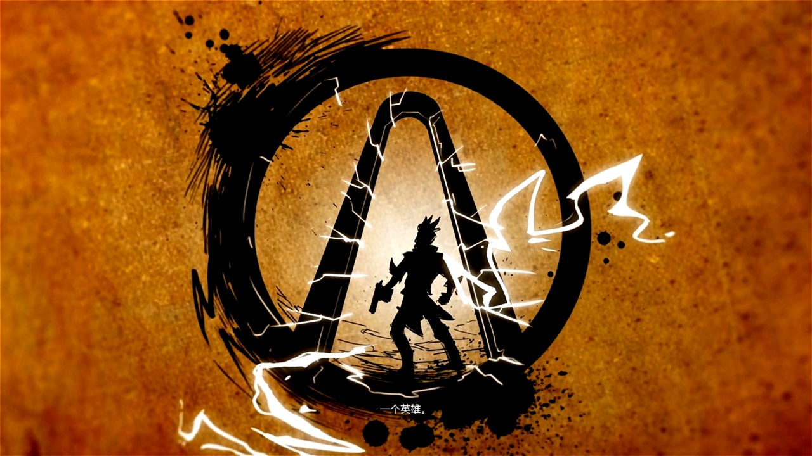
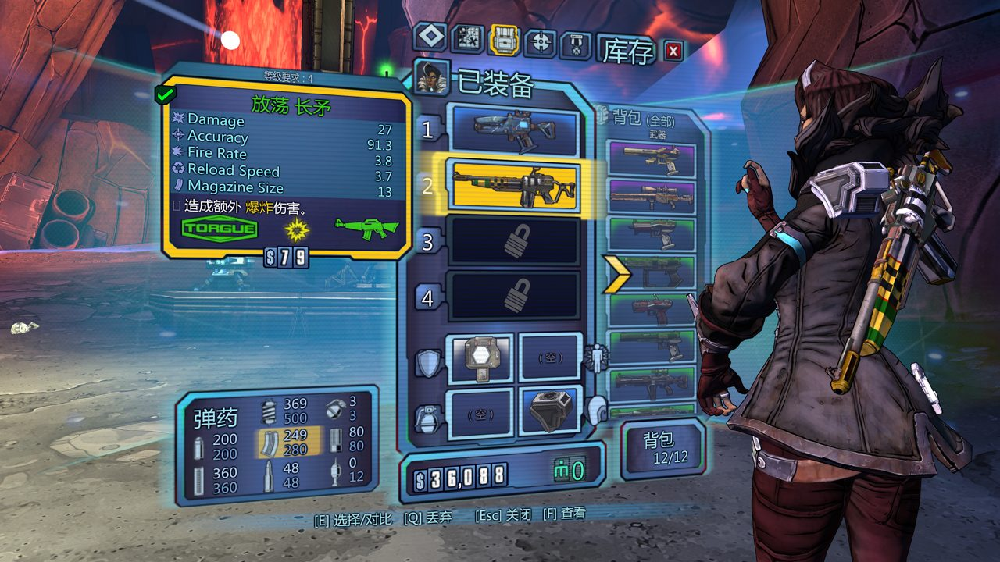

# 《无主之地：前传》简体中文汉化补丁

Borderlands: The Pre-Sequel — Simplified Chinese Localization Patch

[]()
[]()
[]()

把《无主之地：前传》（Borderlands: The Pre-Sequel）的本体 + 4 个 DLC 全面汉化，覆盖菜单、HUD、任务、技能、物品、挑战、地图、字幕等。

- **文本**：本仓库自行翻译（约 5.5 万条），不是套用其他汉化组的译文
- **字体**：借用 3DM 汉化补丁中的中文字体资源（仅字体，不含其文本），详见 [NOTICE.md](NOTICE.md)
- **安装**：一条命令；自动备份、可校验、可一键撤销

## 效果预览

| 主菜单 | 背包 |
|---|---|
|  |  |

| DLC 技能树 | 坏小子挑战 |
|---|---|
|  |  |

| 过场字幕 | 武器名 |
|---|---|
|  |  |

## 内容

| 部分 | 文件数 | 说明 |
|---|---|---|
| 本体本地化 | 839 | `WillowGame/Localization/INT/*.int` |
| Crocus DLC | 30 | `DLC/Crocus/Compat/Localization/INT/` |
| Marigold DLC | 242 | `DLC/Marigold/Compat/Localization/INT/` |
| Petunia DLC | 44 | `DLC/Petunia/Compat/Localization/INT/` |
| Quince DLC | 29 | `DLC/Quince/Compat/Localization/INT/` |
| 中文字体 | 2 (+2 边车) | `Startup.upk`、`Startup_LOC_INT.upk` 及其 `.uncompressed_size` |

合计 **1188 个文件**，全部带 SHA-256 校验（`manifest.sha256`）。

## 系统要求

- Steam 版 **Borderlands: The Pre-Sequel**（Linux / Steam Play Proton）
- 游戏目录内存在 `WillowGame/CookedPCConsole/Startup.upk`
- `bash` + 常见 coreutils（`sha256sum` 或 `shasum`）

> 本补丁面向 **Linux（Proton）** 安装。Windows 下路径结构相同，可手动按映射表覆盖文件。

## 安装

### 方式一：自动脚本（推荐）

```bash
tar xzf bltps-cn-patch-v1.0.tar.gz
cd bltps-cn-patch
bash install.sh
```

脚本会：

1. 自动定位游戏目录（Steam 默认库、`.steam/steam`、`~/Steam`、外挂库 `/media|/mnt|/run/media/*/SteamLibrary`）
2. 把将被覆盖的原始文件备份到 `游戏目录/bltps-cn-backup/`
3. 写入 1184 个 `.int` + 替换 2 个字体包

找不到游戏目录时手动指定：

```bash
bash install.sh --game "$HOME/.local/share/Steam/steamapps/common/BorderlandsPreSequel"
```

只想看会改哪些文件：

```bash
bash install.sh --dry-run
```

### 方式二：手动覆盖

解包后把 `payload/` 内的内容按相同相对路径复制进游戏目录：

| 包内路径 | 游戏内路径 |
|---|---|
| `payload/WillowGame/Localization/INT/*.int` | `WillowGame/Localization/INT/` |
| `payload/WillowGame/CookedPCConsole/Startup.upk` | `WillowGame/CookedPCConsole/` |
| `payload/WillowGame/CookedPCConsole/Startup.upk.uncompressed_size` | 同上 |
| `payload/WillowGame/CookedPCConsole/Startup_LOC_INT.upk*` | 同上 |
| `payload/DLC/<DLC 名>/Compat/Localization/INT/*.int` | `DLC/<DLC 名>/Compat/Localization/INT/` |

> 游戏内 `.int` 文件名是**小写**的；如果覆盖后没生效，检查目录里是否同时存在大小写不同的同名文件（Linux 区分大小写）。

## 校验

```bash
bash install.sh --verify
```

逐文件比对 SHA-256，输出：

```
校验结果: 共 1188 项，正常 1188，不一致 0，缺失 0
PASS - 汉化文件完整
```

游戏更新、Steam 校验或误删之后，都可以用它检查是否需要重装。

## 撤销 / 恢复原版

```bash
bash install.sh --uninstall
```

使用第一次安装时留下的 `游戏目录/bltps-cn-backup/`，把游戏恢复到**安装前**的状态（含删除汉化新增的文件）。

## 常见情况

### Steam 校验了游戏文件，汉化没了

Steam「验证游戏文件完整性」会把被替换的文件还原成英文，并可能删掉新增的 `.int`。直接重装：

```bash
bash install.sh
```

### 游戏更新后启动异常

用 `bash install.sh --uninstall` 回退，或 Steam 校验后重装补丁；确认游戏能正常启动再装汉化。

### 想彻底回到原版英文

`--uninstall` 即可。若备份目录被删，用 Steam 校验恢复被替换的文件，再手动删除汉化新增的 `.int`（`--verify` 会列出缺失项，可反查清单）。

## 已知问题

**HUD 底部经验条左侧显示 `等级 0`（角色实际等级更高）。**

原因：借用的中文字体中数字比原版宽约 25%，而 HUD 的数字栏宽度是固定的两位宽，第二位被裁掉。角色等级在角色选择、菜单里显示正确，不影响游戏。修复需要改字体资源或 Scaleform HUD 组件，风险较高，故保留现状。

其余已知保留英文的内容：厂商名/人名/地名等专名按翻译规范保留原文。

## 目录结构

```
borderlands-tps-chinese-patch/
├── install.sh              # 安装 / 校验 / 撤销
├── manifest.sha256         # 1188 个文件的校验清单
├── README.md
├── NOTICE.md               # 字体来源与版权说明
├── LICENSE                 # 脚本与文档的 MIT 许可
├── docs/screenshots/       # 效果图
└── payload/                # 补丁文件（1188 个）
```

## 版本

**v1.0**（2026-11-09）

- 补丁包：`bltps-cn-patch-v1.0.tar.gz`
- 文件数：1188（1184 个 `.int` + 4 个字体相关文件）
- 覆盖：本体 + Crocus / Marigold / Petunia / Quince

## 致谢与声明

- 字体资源来自 **3DM 轩辕汉化组** 的《无主之地：前传》汉化补丁，版权归原权利人所有。
- 本项目的译文为自行翻译，按 [MIT](LICENSE) 许可发布；字体资源**不适用** MIT，请勿商用或二次分发。
- 仅供个人学习与游玩使用。使用本补丁造成的任何问题由使用者自行承担。
